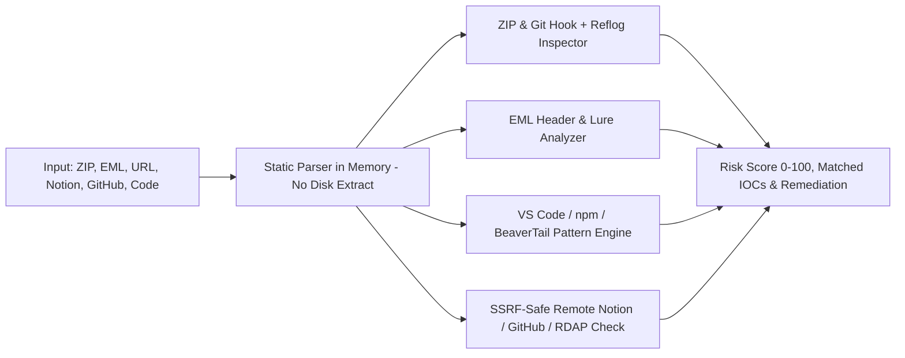

# Contagious Interview Shield

**Zero-execution static security scanner** to protect software engineers and technical recruiters from ***Contagious Interview* (`BeaverTail` / `InvisibleFerret` / `EtherHider`)** and poisoned freelance/contest repository droppers (**PowerShell encrypted `.dat` loaders**, local `PyInstaller` compilers, and Windows crypto clipboard hijackers).

Live free web tool: **[https://www.aldianfazrihady.com/en-us/tools/safety-scanner/](https://www.aldianfazrihady.com/en-us/tools/safety-scanner/)**

---

## Why This Tool Exists

Fake recruiters on Hubstaff Talent, Built In, LinkedIn, Upwork, and Wellfound are now shipping technical assessments inside `.zip` archives on Notion or GitHub repositories that infect developers **before any application code is ever run**:

- **Zero-Python / Zero-IDE `.git/hooks/post-checkout` Traps (`Skyron.zip`):** A `.zip` pre-sets `.git/HEAD` to a `dev` branch where a key file was deleted, tricking candidates into running `git checkout main`. Unlike `git clone`, extracting a `.zip` preserves executable scripts in `.git/hooks/`, firing immediately when `git checkout` runs.
- **VS Code / Cursor `folderOpen` Traps:** `.vscode/tasks.json` uses `"runOn": "folderOpen"` with long whitespace padding to hide `curl | bash` or `cmd.exe` downloaders off the horizontal scrollbar.
- **`BeaverTail` Node.js Loaders & Blockchain Dead-Drops (`EtherHider`):** Obfuscated `errorHandler.js` (`new Function('require', ...)`), portable `Node.js` installers dropped in `~/.task/`, and C2 resolvers querying **TRON** and **BNB Smart Chain** transactions.
- **Poisoned Contest / Fake-Starred GitHub Repos (`nataphong-lab` Windows Crypto-Clippers):** Urgent student/freelance contest repos cloned from legitimate SDKs with inflated star counts instructing victims to run `powershell -Ep Bypass ./install.ps1`, decrypt AES-256-CBC `.dat` blobs via `Invoke-Expression`, compile unsigned `PyInstaller` binaries locally, and hijack copied crypto wallet addresses.

---

## Detection Capabilities

`contagious-interview-shield` inspects every input **100% statically in memory** (zero disk extraction, zero code execution, strict zip-bomb bounds, and SSRF validation on remote lookups):

1. **`.zip` Assessment Archives:**
   - Flags non-sample `.git/hooks/*` (`post-checkout`, `pre-commit`, `pre-push`, etc.) and `.git/HEAD` branch-switch traps.
   - Scans unstripped `.git/logs/HEAD` reflogs for `+0900` (UTC+9) commits, known operator emails, and VPS staging hostnames.
   - Scans `.vscode/tasks.json`, `package.json`, `.github/workflows/*.yml`, `.js`, `.ts`, `.py`, `.sh`, `.cmd`, `.bat`, `.ps1`, and `.conf` files, plus encrypted `.dat` binaries bundled with `.ps1` droppers.
2. **`.eml` Recruiter Emails:**
   - Extracts `From`, `Reply-To`, `Return-Path`, `Message-ID` timestamps (including Dynadot epoch IDs), URLs, and attached `.zip` files.
   - Flags lure instructions (`Unzip` + `git checkout main`) and known spoofed signatures.
3. **URLs, Domains, Notion Pages & GitHub Repos:**
   - **Notion:** Reads public workspace/page metadata and inspects attached `.zip` archives in memory without touching local disk.
   - **GitHub:** Fetches `README.md`, root installers (`.ps1`, `.bat`, `.cmd`, `.sh`, `.conf`, `.dat`), `.vscode/tasks.json`, `package.json`, `server/errorHandler.js`, commit `.patch` timezone headers (`+0900`), and flags freshly created repos with anomalous star-count inflation (`GITHUB_FAKE_STAR_ANOMALY`).
   - **Domains:** Checks RDAP registration age and Firebase Hosting metadata (`/__/firebase/init.json`).
4. **Threat Intel IOC Matching:** Built-in database of verified domains (`ledgeroom.org`, `astrabytesyncs.com`, `kiggla.com`, etc.), emails, GitHub accounts (`nataphong-lab`, etc.), C2 IPs (`84.200.33.163`, `213.173.111.184`, etc.), blockchain dead-drop wallets/txs, and file SHA-256 hashes.

---

## Installation & CLI Usage (Zero External Dependencies)

Requires Python 3.9+ (uses only the Python standard library).

```bash
git clone https://github.com/aldian/contagious-interview-shield.git
cd contagious-interview-shield
pip install -e .
```

### Examples

```bash
# Scan a downloaded Notion assessment archive before extracting it:
contagious-shield ~/Downloads/Skyron.zip

# Scan a suspicious recruiter .eml file:
contagious-shield ~/Downloads/assessment_email.eml

# Scan a Notion link, GitHub repo, email address, or domain:
contagious-shield https://app.notion.com/p/Skyron-41439da2fd1180ba96b2f33e4f221461
contagious-shield career@ledgeroom.org --no-remote

# Emit JSON output (exit code 0 = SAFE, 1 = SUSPICIOUS or CRITICAL):
contagious-shield --json ./suspicious_repo/tasks.json
```

---

## Architecture



---

## Latest Advisories

- [2026-11-25: `nataphong-lab` (`Open-Source-Face-Recognition-Ultimate` / Freelancer `#2804892`) PowerShell `.dat` Dropper -> Local PyInstaller Crypto Clipboard Hijacker](advisories/2026-11-25-nataphong-lab-face-recognition-clipper.md)
- [2026-11-18: Daniel Canup (`career@ledgeroom.org`) / `greaterops-f8d8b` / `Skyron.zip` `.git/hooks/post-checkout` -> TRON/BSC EtherHider Trap](advisories/2026-11-18-ledgeroom-daniel-canup-skyron-git-hooks-trap.md)

---

## License

Apache License 2.0 — see [LICENSE](LICENSE).
