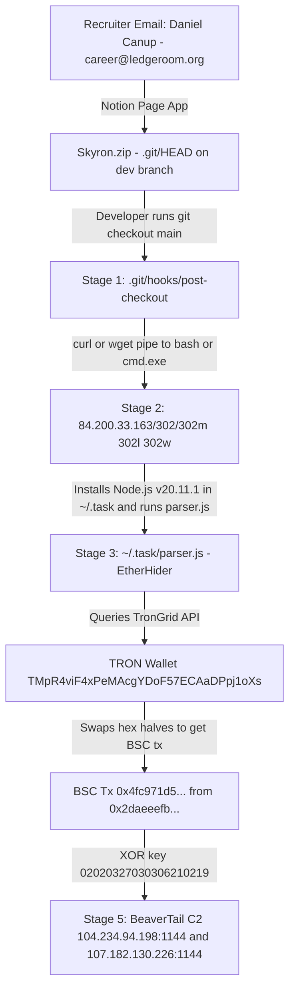

# Threat Advisory: "Daniel Canup" (`career@ledgeroom.org` / `greaterops-f8d8b`) & `Skyron.zip` Zero-Python-Execution `.git/hooks/post-checkout` $\rightarrow$ TRON/BSC EtherHider Trap

**Disclosure Date:** November 18, 2026  
**Researcher:** Aldian Fazrihady (`https://www.aldianfazrihady.com`)  
**Campaign:** *Contagious Interview* / `BeaverTail` / `InvisibleFerret`  
**Live Scanner:** `https://www.aldianfazrihady.com/en-us/tools/safety-scanner/`

---

## Executive Summary

Job seekers on **Hubstaff Talent** and **Built In** applying for Python, Solidity, C++, or Web3 positions at **`ledgeroom.org`** receive an assessment email from **`"Daniel Canup" <career@ledgeroom.org>`** pointing to a Notion page hosting **`Skyron.zip`** (`64,024 bytes`, `SHA-256: 9b92ca76ba12166be5b74c80711cd2a6d088da23bac051b9058b3cadae4130b1`).

Unlike earlier npm/VS Code malware lures, **`Skyron.zip` infects developers even if they never run Python or open an IDE**:
1. `.git/HEAD` is pre-set to branch `dev`, where `skyron/block.py` was intentionally deleted.
2. The email instructs candidates to unzip the archive and run **`git checkout main`** in their terminal to review `skyron/block.py`.
3. Because `.zip` extraction preserves executable **`skyron/.git/hooks/post-checkout`** (`493 bytes`), typing `git checkout main` silently executes a multi-stage downloader that installs portable **Node.js `v20.11.1`** into `~/.task/`, queries a **TRON dead-drop wallet**, decodes a **BNB Smart Chain (BSC)** payload transaction (`EtherHider`), and beacons to **`BeaverTail` / `InvisibleFerret`** C2 servers.



---

## Key Forensics & Attribution Indicators

* **Impersonated Identity:** Real Georgia developer `Daniel Canup` (`github.com/finidev`), surveilled by `+0900` (UTC+9) operative **`awerudev`** (`Olexiy.Buyanskyy@proton.me`, `Corey.Ganong@proton.me`, hosting `defiguard-dev` `Function.constructor` backdoors) and hyphenated lookalike **`fini-dev`** (`davisnguyen654@gmail.com`, Skype `live:jameshess007`).
* **Mangled U.S. Signature:** Emails from `career@ledgeroom.org` (relayed via `webhost-mail-out.dynadot.com` `166.88.19.160` in `+0900` (UTC+9) hours) list Jacksonville, FL phone `+1 (904) 866-4381` paired with **`5510 Philips Highway, 12, NJ`** (mixing Jacksonville street `5510 Philips Highway` with state `NJ`).
* **Firebase Backend & GitHub Link:** `ledgeroom.org` (`www.ledgeroom.org -> company-cc843.web.app`) resolves to Firebase project **`greaterops-f8d8b`** (matching GitHub org **`GreaterOps-Org`** followed by **`auzi-cloud` `"Andrei Kunin"`**).
* **Reflog Proof Inside `Skyron.zip`:** The unstripped `skyron/.git/logs/HEAD` inside `Skyron.zip` records setup commits by **`Julia <dev@greaterops.org>` in `+0900` (UTC+9)** (`1785942716 +0900` – `1785942896 +0900`), followed by 18 test checkouts by `root <root@srv419966518.host>`.

---

## Indicators of Compromise (IOCs)

| Category | Indicator | Notes |
| :--- | :--- | :--- |
| Domain / Email | `ledgeroom.org` / `career@ledgeroom.org` | Impersonation domain registered via Dynadot (`2026-10-07`) |
| Git Author / Reflog | `Julia <dev@greaterops.org>` (`+0900`), `root@srv419966518.host` | Left inside `Skyron.zip/.git/logs/HEAD` |
| Firebase Hosting | `greaterops-f8d8b` / `company-cc843.web.app` | Shared backend for `ledgeroom.org` |
| Notion Lure | `https://app.notion.com/p/Skyron-41439da2fd1180ba96b2f33e4f221461` | Space ID `15a39da2-fd11-8179-ac80-0003c5c33f58` (`thread-mollusk-04b`) |
| Archive SHA-256 | `9b92ca76ba12166be5b74c80711cd2a6d088da23bac051b9058b3cadae4130b1` | `Skyron.zip` (`64,024` bytes) |
| Stage 1–3 C2 Server | `http://84.200.33.163/302/{302m,302l,302w,tokenlinux.sh,token.cmd,parser.js}` | UltaHost / First Colo Frankfurt; `parser.js` SHA-256 `d03934e0...` |
| TRON Dead-Drop | `TMpR4viF4xPeMAcgYDoF57ECAaDPpj1oXs` (`tx 7c85209eec99eb600a7c19773126c9d34d266c3cc6fd6728f87ac2c669ec5fd2`) | Encodes swapped hex of BSC payload transaction |
| BSC Dead-Drop | `0x2daeeefb925fc00df10d928b079daaed07caf037` (`tx 0x4fc971d535ab66f09472d637d4697e464df67172a83616093c6d8776fc219c6e`) | XOR key `02020327030306210219`, Campaign ID `30621346` |
| Stage 4/5 C2 | `104.234.94.198:1144`, `107.182.130.226:1144` | PBKDF2-SHA256 + AES-256-CBC `BeaverTail` loader (`Jg2oE^0&96R#`) |

---

## Check If Your Machine Was Affected

```bash
ls -la ~/.task ~/.npl
```

On Windows PowerShell:

```powershell
Get-ChildItem "$env:USERPROFILE\.task", "$env:USERPROFILE\.npl" -Force -ErrorAction SilentlyContinue
```
