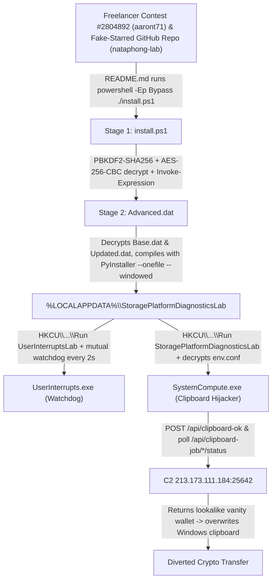

# Threat Advisory: `nataphong-lab` (`Open-Source-Face-Recognition-Ultimate` / Freelancer `#2804892`) Windows PowerShell `.dat` Dropper $\rightarrow$ Local PyInstaller Crypto Clipboard Hijacker

**Disclosure Date:** November 25, 2026  
**Researcher:** Aldian Fazrihady (`https://www.aldianfazrihady.com`)  
**Campaign:** Poisoned Freelance / Coding Contest Windows Crypto-Clipper (*distinct from DPRK Contagious Interview*)  
**Live Scanner:** `https://www.aldianfazrihady.com/en-us/tools/safety-scanner/`

---

## Executive Summary

On November 25, 2026, a brand-new Freelancer.com employer account (**`aaront71`**, registered November 24, 2026) posted a `$100 USD` coding contest (**`#2804892`** — *High-Performance Open-Source Face Recognition*) claiming to be a student whose assignment was due in 3 days. The contest pointed developers to **`https://github.com/nataphong-lab/Open-Source-Face-Recognition-Ultimate`**, a clone of the legitimate `Faceplugin-ltd/Open-Source-Face-Recognition-SDK` repository artificially inflated to **`742` stars in 6 days** on a single-repo, 1-follower account.

Unlike DPRK *Contagious Interview* `.git/hooks` / VS Code `tasks.json` loaders, this operator targets **Windows developers** via explicit setup instructions in **`README.md`**:

```powershell
powershell -Ep Bypass ./install.ps1
```

Static decryption in memory reveals a four-stage Windows malware chain that decrypts AES-256-CBC `.dat` payloads, compiles two unsigned `.exe` binaries locally via `PyInstaller` to evade hash detection, installs `HKCU\...\Run` persistence with mutual-resurrection watchdogs, and replaces copied crypto wallet addresses with attacker-generated vanity addresses served over C2 (`213[.]173[.]111[.]184:25642`).



---

## Key Forensics & Attribution Indicators

- **Fake Repo Credibility:** `nataphong-lab` (`created_at: 2025-04-18`) has `1` follower and `1` public repo (`Open-Source-Face-Recognition-Ultimate`, created `2026-11-19`) boosted to `742` stars.
- **Unmodified Native SDK Binaries:** Comparing SHA-1 tree hashes against upstream `Faceplugin-ltd/Open-Source-Face-Recognition-SDK` confirms `face_util/C/FaceUtil.dll`, `face_util/C/libFaceUtil.so`, `face_feature/GetFeature.py`, and `face_detect/detect_imgs.py` are untouched decoys while `install.ps1`, `Advanced.dat`, `Base.dat`, `Updated.dat`, and `env.conf` were injected at the root.
- **Anti-Analysis / LLM Decoy Docstrings:** Decrypted Python payloads claim *"Headless CLASSROOM PROCESS LAB. No wallet, network, persistence or concealment"* above code registering `HKCU\...\Run` keys, calling Win32 clipboard APIs (`SetClipboardData`), and polling C2 vanity address jobs.
- **Distinct Operator Profile:** Commit patches carry `-0500` EST headers from `nataphong-lab <nataphongnakorn11@outlook.com>` (`README` also lists `nataphong-lab@gmail.com`) rather than the `+0900` UTC+9 reflog / TRON-BSC EtherHider TTPs typical of DPRK *Contagious Interview*.

---

## Indicators of Compromise (IOCs)

| Category | Indicator | Notes |
| :--- | :--- | :--- |
| Freelancer Lure | Contest `#2804892` (`aaront71`) | US account registered `2026-11-24`, `0` reviews |
| GitHub Actor / Repo | `nataphong-lab` / `Open-Source-Face-Recognition-Ultimate` | `742` stars in 6 days, `1` follower, `1` repo |
| Operator Emails | `nataphongnakorn11@outlook.com`, `nataphong-lab@gmail.com` | Commit `.patch` `-0500` author & `README.md` contact |
| C2 Infrastructure | `213[.]173[.]111[.]184:25642` | Decrypted from `env.conf` (`ENV_DATA`, key `StorageLab-EnvKey-2026`); `/api/clipboard-ok` |
| `install.ps1` SHA-256 | `a7fe61e2921e2aac65c75fadb72a8994f3e7386e73c7e089f3404d41cc35a935` | `1,598` bytes (`FaceRecognition-Key-2026`) |
| `Advanced.dat` SHA-256 | `68ec1e12fa8a5c11f71b7cf84e946d76093db62947928f4eec3ee381962e0080` | `5,809` bytes — local PyInstaller dropper |
| `Base.dat` SHA-256 | `7fe030f12518b0e9041eed0048016a382cf4687660f9ad11b103fb07242e116c` | `4,753` bytes — compiled to `UserInterrupts.exe` |
| `Updated.dat` SHA-256 | `f4c07d6865bbfccb11fb0f80ece4c1653d43dc8d2b812a5a3c3de6ab500bfbd0` | `19,681` bytes — compiled to `SystemCompute.exe` |
| `env.conf` SHA-256 | `1f72c0b96b60917a137588151092b164aff22778ab1e34dc81aad761bd25aabb` | `438` bytes — encrypted C2 endpoint config |
| Host Artifacts | `%LOCALAPPDATA%\StoragePlatformDiagnosticsLab` | `SystemCompute.exe`, `UserInterrupts.exe`, `HKCU\...\Run` keys |

---

## Check & Remediate If You Ran `install.ps1` on Windows

In PowerShell:

```powershell
# Inspect persistence paths and registry Run keys
Get-ChildItem "$env:LOCALAPPDATA\StoragePlatformDiagnosticsLab" -Force -ErrorAction SilentlyContinue
Get-ItemProperty "HKCU:\Software\Microsoft\Windows\CurrentVersion\Run" | Select-Object StoragePlatformDiagnosticsLab, UserInterruptsLab

# Check active dropper processes
Get-Process SystemCompute, UserInterrupts -ErrorAction SilentlyContinue
```

If present: create `$env:LOCALAPPDATA\StoragePlatformDiagnosticsLab\stop.signal` (triggers cooperative shutdown via `STOP.exists()`), terminate `SystemCompute.exe` and `UserInterrupts.exe` together, delete the `HKCU\...\Run` values and Start Menu `.lnk` shortcuts, and remove `%LOCALAPPDATA%\StoragePlatformDiagnosticsLab`.
